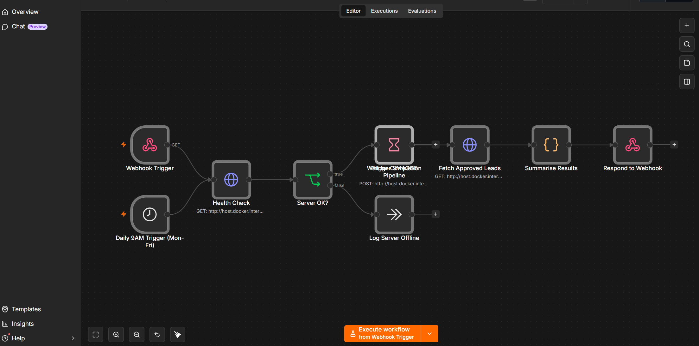

# AgentFlow — Autonomous AI Lead Generation System

> An intelligent multi-agent system that discovers hyper-targeted business leads and generates secure, compliant, personalized outreach — powered by local LLMs, CrewAI, and a custom AI security layer.

---

## Dashboard Preview



---

## What This Project Demonstrates

| Skill Area | Implementation |
|---|---|
| **Multi-Agent Orchestration** | CrewAI sequential pipeline — Scout → Analyst → Writer → Guard |
| **Local LLM Deployment** | Ollama + llama3.2 (tool-calling capable, fully offline) |
| **AI Security & Governance** | Custom 4-layer security scorer (PII · Injection · Hallucination · Tone) |
| **Feedback Loop** | Rejected messages feed back into the Writer agent context |
| **Workflow Automation** | n8n webhook + daily cron trigger via FastAPI |
| **Full-Stack AI Engineering** | FastAPI REST API + live HTML/JS dashboard |
| **Containerisation** | Docker Compose — PostgreSQL + n8n |

---

## Architecture

```
┌─────────────────────────────────────────────────────────────────┐
│                         AgentFlow Pipeline                     │
│                                                                  │
│   ┌─────────┐    ┌──────────┐    ┌────────┐    ┌───────────┐   │
│   │  Scout  │───▶│ Analyst  │───▶│ Writer │───▶│  Security │   │
│   │  Agent  │    │  Agent   │    │ Agent  │    │   Guard   │   │
│   └─────────┘    └──────────┘    └────────┘    └─────┬─────┘   │
│   Discovers       Enriches        Drafts         4-layer check  │
│   leads via       each lead       personalized   PII·Inj·Hal    │
│   CSV/Apollo      with OCR        outreach       ·Tone scoring  │
│   /Hunter         + reasoning     (<150 words)         │        │
│                                                         ▼        │
│                              ┌──────────────────────────────┐   │
│                              │      PostgreSQL Database      │   │
│                              │  leads · analyses · outreach  │   │
│                              │       pipeline_runs           │   │
│                              └──────────────┬───────────────┘   │
└─────────────────────────────────────────────┼───────────────────┘
                                              │
              ┌───────────────────────────────┼────────────────┐
              │                               │                │
        ┌─────▼─────┐                  ┌──────▼──────┐  ┌─────▼────┐
        │  FastAPI  │                  │  Dashboard  │  │   n8n    │
        │  REST API │                  │  (HTML/JS)  │  │ Workflow │
        │  :8001    │                  │   :8001/    │  │  :5678   │
        └───────────┘                  │  dashboard  │  └──────────┘
                                       └─────────────┘
```

---

## Project Structure

```
AgentFlow/
├── agents/
│   ├── scout.py          # Lead discovery agent (mock / Apollo / Hunter)
│   ├── analyst.py        # Lead enrichment agent (OCR + reasoning)
│   └── writer.py         # Personalized outreach drafting agent
├── tools/
│   ├── lead_scraper.py   # CrewAI BaseTool — CSV / API lead fetching
│   └── ocr_tool.py       # CrewAI BaseTool — Tesseract OCR
├── tasks/
│   └── pipeline_tasks.py # CrewAI task definitions with context chaining
├── security/
│   ├── guard.py          # SecurityGuard — orchestrates all checks
│   ├── scorer.py         # SecurityScorer — returns SecurityReport
│   ├── checks/
│   │   ├── pii_check.py          # Regex PII detection (40 pts)
│   │   ├── injection_check.py    # Regex + LLM semantic injection check (30 pts)
│   │   ├── hallucination_check.py# LLM cross-reference check (20 pts)
│   │   └── tone_check.py         # LLM tone appropriateness (10 pts)
│   └── guardrails/
│       ├── config.yml    # NeMo Guardrails config (portfolio documentation)
│       └── main.co       # NeMo Guardrails colang rules
├── feedback/
│   └── loop.py           # FeedbackLoop — rejected messages → Writer context
├── api/
│   └── server.py         # FastAPI server — /run /status /leads /runs /approve
├── static/
│   └── dashboard.html    # Live dashboard — 4 pages, full navigation
├── database/
│   └── init.sql          # PostgreSQL schema
├── data/
│   └── mock_leads.csv    # 10 sample SaaS leads
├── n8n/
│   └── agentflow_workflow.json  # Importable n8n workflow
├── crew.py               # Main pipeline entry point
├── docker-compose.yml    # PostgreSQL + n8n containers
├── requirements.txt      # Python dependencies
└── .env.example          # Environment variable template
```

---

## Quick Start

### Prerequisites
- Python 3.12
- Docker Desktop
- [Ollama](https://ollama.ai) with `llama3.2` pulled
- [Tesseract OCR](https://github.com/UB-Mannheim/tesseract/wiki) (Windows)

### 1. Clone & set up environment
```bash
git clone https://github.com/jagadish/agentflow.git
cd agentflow

py -3.12 -m venv venv
venv\Scripts\activate        # Windows
# source venv/bin/activate   # macOS/Linux

pip install -r requirements.txt
```

### 2. Configure environment
```bash
copy .env.example .env
# Edit .env with your settings
```

### 3. Start infrastructure
```bash
docker-compose up -d         # PostgreSQL + n8n
ollama pull llama3.2         # Download local LLM
```

### 4. Run the pipeline (Terminal 1)
```bash
python crew.py
```

### 5. Start the API server (Terminal 2)
```bash
uvicorn api.server:app --host 0.0.0.0 --port 8001 --reload
```

### 6. Open the dashboard
```
http://localhost:8001/dashboard
```

---

## The 4-Phase Build

### Phase 1 — Multi-Agent Pipeline
Three CrewAI agents running sequentially on a local LLM:
- **Scout** uses `LeadScraperTool` to fetch leads from mock CSV, Apollo, or Hunter.io
- **Analyst** enriches each lead with `OCRTool` (Tesseract) + LLM reasoning
- **Writer** drafts a personalised outreach email per lead (under 150 words)

### Phase 2 — Security Guard Layer
A custom 4-layer security scorer intercepts every Writer output before it reaches the database:

| Check | Points | Method |
|---|---|---|
| PII Detection | 40 | Regex patterns (email, phone, SSN, credit card) |
| Prompt Injection | 30 | Regex + Ollama LLM semantic check |
| Hallucination | 20 | LLM cross-references message facts vs source data |
| Tone | 10 | LLM appropriateness assessment |

Messages scoring below 70/100 are automatically rejected and logged.

The `security/guardrails/` folder documents how this maps to a [NeMo Guardrails](https://github.com/NVIDIA/NeMo-Guardrails) integration pattern (C++ build tools required on Windows — implemented natively instead).

### Phase 3 — Automation & Feedback Loop
- **FastAPI server** exposes `/run`, `/status`, `/leads`, `/runs`, `/approve`, `/schedule`, `/jobs`, `/jobs/due`, `/last-run` endpoints
- **Scheduling (Design A)** — jobs the user schedules live in PostgreSQL (in-memory fallback if the DB is down). **n8n polls `GET /jobs/due` every 5 minutes** and, when a job is due, POSTs `/run` with that job's parameters, then marks it fired via `/jobs/{id}/triggered`. Times the user picks genuinely cause n8n to re-fire the pipeline — nothing is hardcoded.
- **Feedback loop** queries previously rejected messages from PostgreSQL and injects them into the Writer agent's context so it learns from past mistakes

### Phase 4 — Dashboard & Portfolio
- Live HTML/JS dashboard served via FastAPI at `/dashboard`
- Pages: Dashboard (live run output + Run Analytics), Leads, Security Logs, **Download** (Power BI–style decision intelligence), Settings
- **Download page** — slicer filters (industry / job title / location / interest level), KPI strip, industry donut, job-title & location bars, **Decision Interest Levels** (highly interested / recommended / medium / low / no interest, derived from Guard's security score + approval), score spread, company leaderboard, leads-over-time trend and the drafted outreach messages
- **Download PDF** — one click captures the whole decision report via html2canvas + jsPDF (multi-page A4); falls back to the browser print dialog ("Save as PDF") if the CDN is unreachable
- Responsive/mobile: off-canvas sidebar with hamburger below 900px, grids collapse 4→2→1, tables scroll horizontally, canvases redraw on resize; a print stylesheet prints only the active page
- Approve / Reject buttons feed back into the pipeline via `/approve`
- Settings page includes a "Run Pipeline Now" button
- Auto-refreshes every 30 seconds; on server restart the last run is **re-hydrated from PostgreSQL**, so the dashboard is never blank after a deploy
- Everything shown comes from real agent/n8n runs — no mock/demo data anywhere

---

## Environment Variables

```env
# ── LLM Provider Chain (cloud-hostable) ────────────────────────────────
# Priority order. First healthy provider wins; rest are automatic fallbacks
# on timeout/error. Set to 'ollama' only for local/offline dev.
LLM_PROVIDERS=openrouter,groq,huggingface,ollama
LLM_TIMEOUT=25

# OpenRouter (primary)
OPENROUTER_API_KEY=your_key_here
OPENROUTER_MODEL=meta-llama/llama-3.3-70b-instruct

# Groq (fastest free fallback)
GROQ_API_KEY=your_key_here
GROQ_MODEL=llama-3.3-70b-versatile

# Hugging Face (backup — free Inference Providers)
HUGGINGFACEHUB_API_TOKEN=your_hf_token_here
HF_MODEL=meta-llama/Llama-3.3-70B-Instruct

# Ollama (optional local fallback)
OLLAMA_BASE_URL=http://localhost:11434
OLLAMA_MODEL=llama3.2

# Lead Source: mock | apollo | hunter
LEAD_SOURCE=mock

# Apollo (optional)
APOLLO_API_KEY=your_key_here

# Hunter.io (optional)
HUNTER_API_KEY=your_key_here

# Targeting
TARGET_INDUSTRY=SaaS
TARGET_JOB_TITLE=Head of Growth
TARGET_LOCATION=United States

# Database
POSTGRES_HOST=localhost
POSTGRES_PORT=5432
POSTGRES_DB=agentflow_db
POSTGRES_USER=agentflow
POSTGRES_PASSWORD=agentflow_secret

# Tesseract (Windows)
TESSERACT_PATH=C:\Program Files\Tesseract-OCR
```

---

## LLM Failover (why it's cloud-hostable)

Every LLM call — the 3 CrewAI agents **and** the security checks — routes through
`llm_config.py`. It probes providers in `LLM_PROVIDERS` order, caches the fastest
healthy one, and **fails over automatically** when a provider times out or errors:

```
openrouter ──(slow/down)──▶ groq ──▶ huggingface ──▶ ollama (local)
     ▲                        ▲
  primary                fastest free
```

This removes the hard dependency on local Ollama, so the pipeline runs on any
cloud host that can reach the internet.

---

## Deploying (cloud, free tier — **no credit/debit card**)

> **📖 Full step-by-step guide: [HOSTING.md](HOSTING.md)** (Render + Neon + free
> cron, ~10 minutes). Everything below is the short version.

Netlify **cannot** host this backend (no Python runtime / DB / long requests).
The stack that works — all free-tier, **email sign-up only, no card**:

| Piece | Free host | How |
|---|---|---|
| FastAPI + agents + dashboard | **Render.com** | `render.yaml` in repo → New ▸ Blueprint; serves `/dashboard` on the same origin |
| PostgreSQL | **Neon / Supabase** | set `DATABASE_URL` (parsed + `sslmode=require` by `db_config.py`) |
| LLMs | **OpenRouter / Groq / HF** | set keys in Render env vars (`LLM_PROVIDERS` preset in `render.yaml`) |
| Scheduler | **cron-job.org** *or* local n8n | free cron POSTs `/scheduler/tick` every 5 min — no n8n hosting needed |
| Dashboard | Render (bundled) | never split-host it: the page uses `location.origin`, so it must sit on the same host as the API |

On startup the app auto-migrates an empty cloud DB (`migrations/run.py`) and
hydrates the dashboard's last run from Postgres, so a fresh deploy shows real
data instead of blanks. `Procfile` + `render.yaml` are included; build command
`pip install -r requirements.txt`, start `uvicorn api.server:app --host 0.0.0.0 --port $PORT`.

> Note: Render free tier sleeps after ~15 min idle (first wake-up ~30–50 s) and
> may kill very long runs. The 5-minute scheduler poll keeps it awake during
> the day; see HOSTING.md for an uptime-monitor trick to keep it on 24/7.

---

## n8n workflow — import & activate

The workflow (`n8n/agentflow_workflow.json`) uses the **modern IF-node schema**
(`parameters.conditions` + `typeVersion 2`) and polls the FastAPI job queue.

**Importing a workflow deactivates it** in n8n, so after every import you must
re-activate it — otherwise nothing fires:

```bash
# 1. Import the workflow (UI: Workflows ▸ Import from File, or CLI:)
n8n import:workflow --input=n8n/agentflow_workflow.json

# 2. Re-activate it (import leaves it inactive!)
n8n update:workflow --id=agentflow-pipeline-001 --active=true
```

Then restart n8n (`docker-compose restart n8n`) and confirm the workflow shows
as **Active**. Every HTTP URL in the workflow reads
`={{ ($env.AGENTFLOW_API_URL || 'http://host.docker.internal:8001') + ... }}` —
so set `AGENTFLOW_API_URL=https://<your-app>.onrender.com` in n8n's env to drive
the **hosted** API, or leave it unset to keep driving localhost. Verify the
chain end-to-end:

1. Schedule a run from the dashboard (Settings ▸ schedule) or wait for the
   5-minute poll.
2. `GET /jobs/due` returns the due job → n8n POSTs `/run` → crew runs →
   `/jobs/{id}/triggered` marks it fired.
3. Check the run appears in the dashboard's Run History with trigger source
   `n8n`.

> **Hosting without n8n:** `POST /scheduler/tick` performs that same
> check → fire → acknowledge sequence inside the API. Point any free cron
> (e.g. cron-job.org) at it every 5 minutes and schedules work in the cloud
> with zero n8n hosting. If both n8n and a cron run, whichever fires first
> marks the job done — jobs can never double-fire.

> If you edit the IF nodes in the n8n UI, keep the modern schema — legacy IF
> parameters (`conditions.boolean` arrays) silently break the due-job branch.

---

## Security Score Breakdown

```
100 pts total
├── PII Check         (40 pts) — HARD FAIL if any PII detected
├── Injection Check   (30 pts) — Regex layer + LLM semantic layer
├── Hallucination     (20 pts) — LLM fact cross-reference
└── Tone              (10 pts) — LLM appropriateness check

≥ 70 pts → Approved ✓
< 70 pts → Rejected ✗ (logged with reason, fed back to Writer)
```

---

## Tech Stack

| Layer | Technology |
|---|---|
| Agent Framework | [CrewAI](https://crewai.com) 1.x |
| Local LLM | [Ollama](https://ollama.ai) + llama3.2 |
| OCR | Tesseract + pytesseract + OpenCV |
| Database | PostgreSQL 15 (Docker) |
| ORM | SQLAlchemy + psycopg2 |
| API | FastAPI + Uvicorn |
| Workflow Automation | n8n (Docker) |
| Frontend | Vanilla HTML/JS + Tailwind CSS + Material Symbols |
| Containerisation | Docker Compose |
| Security | Custom Python layer + NeMo Guardrails pattern |

---

## Roadmap

- [ ] Apollo & Hunter.io live API integration
- [ ] Email sending via SendGrid / Gmail API
- [ ] Multi-tenant support
- [ ] Slack notification on pipeline completion
- [ ] Fine-tuned local model for outreach quality

---

*Built by S.D.Jagadish · Portfolio project showcasing autonomous multi-agent AI systems*
